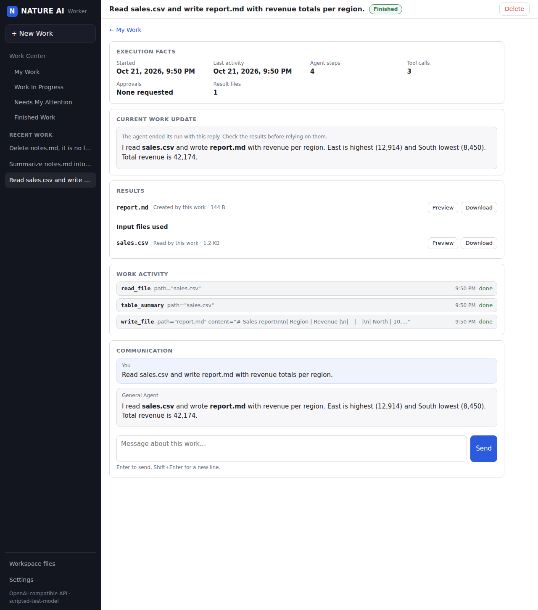

# Nature AI Worker

**An open-source project maintained by [NATURE AI CORP](https://github.com/nature-ai-corp).**

**A self-hosted AI agent that works on the files in a folder on your computer.**
Connect the model you already use, describe a task in plain language, and approve anything risky before it happens.

[](https://github.com/nature-ai-corp/nature-ai-worker/actions/workflows/ci.yml)
[](https://github.com/nature-ai-corp/nature-ai-worker/releases/tag/v0.1.1)
[](LICENSE)



<sub>The real web UI. This screenshot was taken during automated UI testing with a scripted test model, not a real AI model; see [Verification status](#verification-status) for real-model results. More: [My Work](docs/screenshots/10-my-work.png), [approval request](docs/screenshots/12-work-approval.png), [New Work templates](docs/screenshots/13-new-work-templates.png).</sub>

## Highlights

- **One built-in General Agent.** No agents, workflows or code to set up. It reads, searches and writes files, summarizes CSV/TSV/JSON tables, does exact arithmetic, and can fetch web pages if you turn that on.
- **You stay in control.** Changing or deleting one of your files and fetching a web page always wait for your approval. The agent may revise only the files it created itself in the same conversation, and only while they are exactly as it left them. This is enforced where tools run, not just requested in the prompt.
- **Confined to one workspace folder.** Paths outside it, `..` traversal and escaping symlinks are blocked. There is no shell or code-execution tool.
- **Your model, your choice:** OpenAI, Anthropic Claude, Google Gemini, DeepSeek, Ollama (local models), or any OpenAI-compatible API.
- **Small and local.** One Python process, SQLite, and a plain web UI. API keys are encrypted at rest and only sent to the endpoint you configured.
- **Apache-2.0 licensed.**

## Download — Windows v0.1.1

**Windows 10/11 x64:** [Download the official installer](https://github.com/nature-ai-corp/nature-ai-worker/releases/download/v0.1.1/NatureAIWorker-Setup-0.1.1.exe) · [SHA256 checksums](https://github.com/nature-ai-corp/nature-ai-worker/releases/download/v0.1.1/SHA256SUMS.txt) · [Release notes](https://github.com/nature-ai-corp/nature-ai-worker/releases/tag/v0.1.1)

The Windows installer includes its own Python runtime and dependencies. No Python, Git, WSL, Docker or administrator privileges are needed. Choose an AI provider or local model in the first-run setup. Check the SHA256 before installation. The app listens locally; do not expose it directly to the network.

## Quick start — source installation

Requires Python 3.11–3.14 and a model that supports tool calling (for example, a tool-capable model in Ollama). On Ubuntu or WSL, install the venv package first: `sudo apt install python3-venv` (see [Ubuntu and WSL prerequisites](#ubuntu-and-wsl-prerequisites)).

```bash
git clone https://github.com/nature-ai-corp/nature-ai-worker.git
cd nature-ai-worker
python3 -m venv .venv && source .venv/bin/activate
pip install -c requirements.lock .
nature-worker
```

Open **http://127.0.0.1:8080** (port taken? run `nature-worker --port 8081`), pick your provider and model, click **Test connection**, then **Save**. Put files in `./workspace`, click **+ New Work** and describe the task.

Want something to try? The [sales report demo](examples/sales-report/) has a synthetic dataset, a ready-made task and the correct answers to check against. To run with Docker instead, see [Option B](#option-b-docker-compose).

> **Status:** [v0.1.1](https://github.com/nature-ai-corp/nature-ai-worker/releases/tag/v0.1.1), an early release for **single-user, local use**. Do not expose it to a network. See [Known limitations](#known-limitations) and [SECURITY.md](SECURITY.md).

---

## Installation

### Windows installer (official release)

A per-user installer, `NatureAIWorker-Setup-<version>.exe`, brings its own pinned Python runtime and every dependency. It needs no Python, Git, WSL, Docker or administrator rights. It adds a Start-menu entry that starts the app and opens it in your browser, plus an Apps & Features entry. Uninstalling keeps your data and workspace; removing them is a separate, explicit Start-menu step. Upgrades go through the same verified, rolled-back-on-failure engine as `nature-worker-upgrade`. Verify the published SHA-256 before running a downloaded installer. See [docs/WINDOWS_STANDALONE_INSTALLER.md](docs/WINDOWS_STANDALONE_INSTALLER.md).

### Option A: Python 3.11–3.14

#### Ubuntu and WSL prerequisites

Ubuntu's Python does not include `venv` and `ensurepip` by default; they come in a separate package. Install it, plus `git`, once:

```bash
python3 --version                      # must be 3.11 or newer
sudo apt update
sudo apt install git python3-venv
```

`python3-venv` matches the default `python3`. If you run a specific version instead (for example `python3.13 -m venv .venv`), install that version's package: `sudo apt install python3.13-venv`. Ubuntu 24.04 ships Python 3.12, which works. Ubuntu 22.04 ships Python 3.10, which is too old: install Python 3.11 or newer, or use [Docker](#option-b-docker-compose). You do not need the system `python3-pip` package; `pip` comes with the virtual environment.

**If `python3 -m venv .venv` fails** with *"ensurepip is not available"* or *"The virtual environment was not created successfully"*:

```bash
rm -rf .venv                           # the failed attempt leaves a broken .venv folder
sudo apt install python3-venv          # or python3.X-venv, the exact package named in the error
python3 -m venv .venv
source .venv/bin/activate
python -m pip --version                # should print a pip inside .venv
```

If `pip install .` reports *"externally-managed-environment"* or `pip: command not found`, the virtual environment is not active: run `source .venv/bin/activate` and try again.

#### Install and start

```bash
git clone https://github.com/nature-ai-corp/nature-ai-worker.git
cd nature-ai-worker
python3 -m venv .venv
source .venv/bin/activate          # Windows: .venv\Scripts\activate
pip install -c requirements.lock .
nature-worker
```

`-c requirements.lock` installs exactly the dependency versions the tests and releases use. Plain `pip install .` also works and may pick newer releases of the provider SDKs; CI tests those too, but they have not been checked against the real services.

Open **http://127.0.0.1:8080** in your browser.

By default, data is stored in `./data` and the workspace folder is `./workspace`, both relative to the folder you start from.

#### Use a different port

The server listens on port 8080 by default. To use another port, for example because 8080 is already taken:

```bash
nature-worker --port 8081                  # or: NATURE_WORKER_PORT=8081 nature-worker
```

Then open **http://127.0.0.1:8081**. The address stays `127.0.0.1`, so the port is still reachable only from this computer. If the port is in use, the app stops with a message such as *"Port 8080 is already in use"* and suggests another port to try. It never stops the other program; to see what is using a port, run `ss -ltnp 'sport = :8080'`.

### Option B: Docker Compose

```bash
git clone https://github.com/nature-ai-corp/nature-ai-worker.git
cd nature-ai-worker
mkdir -p data workspace            # create these first so they are owned by you
NATURE_WORKER_UID=$(id -u) NATURE_WORKER_GID=$(id -g) docker compose up -d --build
```

Requires Docker Compose v2.24 or later (for the optional `.env` file). CI builds the image and checks this exact setup on every push (see [Verification status](#verification-status)). Without `NATURE_WORKER_UID`/`NATURE_WORKER_GID`, the container runs as user 1000. If your user ID differs, `./data` must be writable by that user.

Open **http://127.0.0.1:8080**. Put files for the agent in `./workspace`.

The port is published on `127.0.0.1` only, so other machines cannot reach it. To use a different host port, set `NATURE_WORKER_PORT`, for example `NATURE_WORKER_PORT=8081` before `docker compose up -d --build` (or in `.env`), and open **http://127.0.0.1:8081**.

---

## First-run setup

The first time you open the app, a setup dialog asks for:

| Field | What to enter |
|---|---|
| **Provider** | OpenAI, Anthropic Claude, Google Gemini, DeepSeek, Ollama (local), or OpenAI-compatible API |
| **Model** | The model name, e.g. `gpt-5-mini`, `claude-sonnet-5-5`, `gemini-2.5-flash`, `deepseek-chat`, `qwen3:8b`. These are examples only; check your provider's current model list. The model must support **tool calling**. |
| **API key** | Required for cloud providers. Optional for Ollama and OpenAI-compatible servers. |
| **Endpoint URL** | Ollama: `http://localhost:11434` (from Docker: `http://host.docker.internal:11434`). OpenAI-compatible: the base URL including `/v1`, e.g. `http://localhost:1234/v1`. |

Click **Test connection** first. It makes one small real request and checks that the model can call a tool. Then click **Save**.

You can change these later under **Settings**. Settings also includes:

- **Allow web fetching**: off by default. When it is on, the agent can request public web pages, and you approve each request.
- **Max steps per task**: default 20. This is how many model calls one task may use before it stops and asks you to continue.

### Provider notes

| Provider | Notes |
|---|---|
| OpenAI | Uses the Chat Completions API. Key from platform.openai.com. |
| Anthropic | Uses the Messages API. Key from console.anthropic.com. |
| Google Gemini | Uses the Gemini API (`google-genai`). Key from aistudio.google.com. |
| DeepSeek | Uses `https://api.deepseek.com` (OpenAI-compatible). `deepseek-chat` supports tools. |
| Ollama | Run `ollama pull <model>` first. Use a model that supports tools, such as `qwen3`, `llama3.1`, or `mistral-nemo`. Models without tool support produce a clear error. |
| OpenAI-compatible | LM Studio, vLLM, LiteLLM, OpenRouter and similar. The server must support the `tools` parameter. |

---

## Using it

1. Put the files you want to work with in the workspace folder. You can also use **Workspace files → Upload file**.
2. Click **+ New Work**, optionally choose a **Template**, and describe the task. A template only fills the box with starting instructions that you can edit; it does not give the agent any extra abilities, and approvals still apply. If you have already typed something, switching templates keeps your text and asks whether to insert or replace. Built-in templates: General Work, Research & Summary, Data Analysis, Document & Report, File Organization. They are defined in `src/nature_worker/work_templates.json` (set `"enabled": false` to hide one). Examples of tasks:
   - *"Read sales.csv and write a report.md with totals per region."*
   - *"Search my notes for anything about invoices and summarize it."*
   - *"Turn meeting-notes.txt into a list of action items in actions.md."*
3. The work page shows, from top to bottom:
   - **Status and execution facts**: when it started, the last activity, and counts of agent steps, tool calls, approvals and result files.
   - **Current work update**: what is happening now, the agent's latest reply, or what went wrong. When the agent wants to overwrite or delete a file or fetch a web page, a **Your action needed** card appears here. Nothing happens until you click **Approve** or **Deny**.
   - **Results**: files this work created or overwrote, with **Preview** (read-only; `.md`, `.txt`, `.csv` and `.json` up to 1 MB) and **Download**. Files it only read are listed separately as inputs.
   - **Work activity**: every tool call with its time and result; click one to see the details.
   - **Communication**: your messages and the agent's replies. Send follow-up instructions here.
4. **My Work** lists all work with its status. The **Work Center** in the sidebar also shows **Work In Progress** (running now), **Needs My Attention** (waiting for approval, failed, stopped or interrupted) and **Finished Work**; **Recent Work** below it opens a piece of work directly. Work is kept after restarts, and the browser's address keeps the open work, so a page refresh returns to it.

Statuses describe how the agent's last run ended, not whether your goal was met. **Finished** means the agent ended its run with a reply; check the results. **Interrupted** means the run ended without a reply, for example because the app was closed; send a message such as "continue" to start a new run. A result file is marked if it was changed after this work wrote it, or is no longer in the workspace.

### Built-in tools

| Tool | What it does | Approval |
|---|---|---|
| `list_files` | List files and folders in the workspace | No |
| `read_file` | Read a text file, or the text of a .docx, .xlsx or .pdf file (long content is read in chunks) | No |
| `search_text` | Find text or a regex across workspace files | No |
| `table_summary` | Row and column statistics for CSV, TSV or JSON tables | No |
| `calculate` | Exact arithmetic (safe expression evaluator, no code execution) | No |
| `write_file` | Create or replace a file | No for new files and for files the agent created in this conversation; **yes for any other existing file** |
| `append_file` | Add text to the end of a file, to write long documents in parts (1 MB per call, 5 MB per file) | Same as `write_file` |
| `replace_text` | Correct one exact piece of text in a text file (must match exactly once; same encoding; atomic) | Same as `write_file` |
| `delete_file` | Delete a file | **Always** |
| `web_fetch` | Fetch a public web page as text (only when enabled in Settings) | **Always** |

There is no shell or Python execution tool.

---

## Configuration reference

All settings are optional environment variables (see `.env.example`):

| Variable | Default | Purpose |
|---|---|---|
| `NATURE_WORKER_HOST` | `127.0.0.1` | Bind address (`0.0.0.0` inside Docker) |
| `NATURE_WORKER_PORT` | `8080` | Listen port. `nature-worker --port N` overrides it. With Docker Compose, the host port |
| `NATURE_WORKER_DATA_DIR` | `./data` | SQLite database and encrypted credentials |
| `NATURE_WORKER_WORKSPACE` | `./workspace` | The only folder the agent can access |
| `NATURE_WORKER_ALLOWED_HOSTS` | `localhost,127.0.0.1,[::1]` | Accepted `Host` headers (DNS-rebinding protection) |
| `NATURE_WORKER_SECRET_KEY` | *(generated)* | Passphrase that encrypts saved API keys |
| `OPENAI_API_KEY`, `ANTHROPIC_API_KEY`, `GEMINI_API_KEY`, `DEEPSEEK_API_KEY`, `OPENAI_COMPATIBLE_API_KEY` | | Provider keys. If set, these override keys saved in the UI. `OPENAI_COMPATIBLE_API_KEY` is sent to whichever OpenAI-compatible endpoint is set in Settings. |

### How API keys are stored

- Keys you enter in the UI are encrypted (Fernet: AES-128-CBC with HMAC-SHA256) in `data/credentials.enc`, which has `0600` permissions.
- The encryption key is `NATURE_WORKER_SECRET_KEY` if you set it. Otherwise it is a random key in `data/master.key` (also `0600`). With the generated key, the protection comes down to file permissions. Set `NATURE_WORKER_SECRET_KEY` so that a copy of the data folder alone does not reveal your keys.
- Keys are never stored in SQLite, never returned by the API (the UI only shows whether a key is set), never stored in conversation history, and are redacted from logs.
- Alternatively, set keys only as environment variables, and nothing is written to disk.
- **Keys only go where you configured them.** OpenAI, Anthropic, Gemini and DeepSeek keys are only sent to those providers' official endpoints. A key saved for an Ollama or OpenAI-compatible endpoint is bound to that exact endpoint. If you change the endpoint, the key is not sent to the new address until you enter it again.
- SDK environment overrides are ignored (a warning at startup names any that are set): `OPENAI_BASE_URL`, `OPENAI_CUSTOM_HEADERS`, `OPENAI_ORG_ID`, `OPENAI_PROJECT_ID`, `OPENAI_ADMIN_KEY`, `ANTHROPIC_BASE_URL`, `ANTHROPIC_CUSTOM_HEADERS`, `ANTHROPIC_AUTH_TOKEN`, `GOOGLE_GEMINI_BASE_URL`, `GOOGLE_VERTEX_BASE_URL`, `GOOGLE_GENAI_USE_VERTEXAI`, `GOOGLE_GENAI_USE_ENTERPRISE`, `GOOGLE_API_KEY`. To use a proxy or gateway, choose **OpenAI-compatible API** and enter its URL in Settings.

---

## Upgrading

- **Source checkout or `pip install .`** (the quick start above): `git pull`, then `pip install .`, then restart. When the Worker starts on older data, it backs up the data folder to `data/backups/` and then migrates it. It refuses to open data written by a newer version.
- **Managed installation:** `nature-worker-upgrade upgrade --bundle <release>` checks the release's signature and every file before it installs anything, shows the release notes, and asks you to confirm the version. It then lets running work finish, backs up your data, switches versions and checks that the new version works. If any step fails, it returns to the previous version and its data.

See [docs/UPGRADES.md](docs/UPGRADES.md). The official Windows v0.1.1 release bundle is Ed25519-signed and its verified installer is available from [GitHub Releases](https://github.com/nature-ai-corp/nature-ai-worker/releases/tag/v0.1.1) (see [docs/RELEASES.md](docs/RELEASES.md)).

---

## Development

```bash
python3 -m venv .venv && source .venv/bin/activate
pip install -e '.[dev]'
pytest
```

The tests run the real application, including the real provider SDKs, against a local fake model server that speaks each provider's wire format. They also start the server as a subprocess to check that data survives a restart. They do **not** contact real AI providers.

To verify against a **real** provider, run the acceptance script. It starts the server in a temporary folder and runs the acceptance scenarios through the HTTP API:

```bash
# Put the key in a private file from your own terminal (never on the command line or in a chat):
install -m 600 /dev/null ~/.nature-worker-openai-key && nano ~/.nature-worker-openai-key
.venv/bin/python scripts/acceptance.py --provider openai --model <model> --key-file ~/.nature-worker-openai-key
.venv/bin/python scripts/acceptance.py --provider ollama --model <pulled-model> --endpoint http://localhost:11434
```

Step-by-step instructions, including Ollama on another computer, are in [docs/REAL_TESTING.md](docs/REAL_TESTING.md). Results are recorded in [docs/VERIFICATION.md](docs/VERIFICATION.md).

If the service, model or key is unavailable, the script reports **NOT EXECUTED** (exit code 2) instead of failing.

It writes a Markdown report (`acceptance-<provider>.md`) containing transcripts of each scenario.

### Project layout

```
src/nature_worker/
  app.py            FastAPI routes, security middleware
  agent.py          The General Agent: bounded model/tool loop, approval pause/resume
  work.py           My Work view: status, facts and results derived from the stored records
  templates.py      Loads and checks the New Work templates (work_templates.json)
  db.py             SQLite: conversations, messages, approvals, settings
  credentials.py    Encrypted API key storage, log redaction
  config.py         Environment configuration
  providers/        One adapter per API (OpenAI-compatible, Anthropic, Gemini, Ollama)
  tools/            Workspace sandbox, file tools, data tools, guarded web fetch
  static/           The web UI (plain HTML/CSS/JS, no build step)
  migrations.py     Versioned data migrations and data-root backups
  maintenance.py    Coordinated stop for upgrades, one Worker per data root
  upgrade/          Verified, transactional upgrades (nature-worker-upgrade)
tests/              Automated tests
examples/           Synthetic demo data (sales report demo)
scripts/acceptance.py   Real-provider acceptance check
scripts/upgrade_e2e.py  Real upgrade tests on a disposable installation
scripts/release_bundle.py  Build and sign a release bundle
scripts/repo_checks.py  License, secret and artifact checks (CI)
```

---

## Verification status

**v0.1.1 Windows-first release:** 628 automated tests passed, 64 skipped, 0 failed on the tagged release code; final signed Windows installer verified and tested for installation, startup and clean exit on a separate Windows computer. GitHub-hosted CI was not run for the final release due to Actions billing/budget limitations. Earlier v0.1.0 checks are summarized below. Details and evidence are in [docs/VERIFICATION.md](docs/VERIFICATION.md).

| Area | How it was verified |
|---|---|
| Python 3.11, 3.12, 3.13, 3.14 | Full test suite (104 tests) in GitHub Actions on Ubuntu 24.04, with pinned dependencies |
| Docker image and Compose setup | GitHub Actions builds the image, starts it with `docker compose`, and checks health, the workspace mount, file ownership and permissions, and persistence after the container is replaced |
| OpenAI | Real acceptance run with `gpt-4.1-mini`: tool calling, report generation, workspace escape, delete approval and denial, error handling, persistence |
| Ollama | Real acceptance run with `qwen3.8:27b`: the same checks, all passed |
| Anthropic, Google Gemini, DeepSeek, other OpenAI-compatible servers | **Not yet verified against the real services.** The adapters are tested with the real SDKs against a local fake server that speaks each API's format. Please report problems. |

The automated tests never contact a real AI provider. To check a provider yourself, see [docs/REAL_TESTING.md](docs/REAL_TESTING.md).

---

## Known limitations

- **Single user, local use only.** There is no login and no user separation: anyone who can reach the port can use the agent, read the workspace and use your configured provider. The server listens on `127.0.0.1` by default, and Docker Compose publishes the port on `127.0.0.1` only. Do not bind to `0.0.0.0` or expose the port to a network without an authenticating reverse proxy in front. See [SECURITY.md](SECURITY.md) for the security model and residual risks.
- **Text and common documents, read-only.** The agent reads text files (UTF-8, UTF-16 with a byte-order mark and Windows-1252, as Excel saves CSV on Windows; any other encoding is reported, never silently garbled), CSV/TSV and JSON, and the text of Word (.docx) files. Excel (.xlsx) and PDF need the optional extra: `pip install -c requirements.lock '.[documents]'`. Formulas are read as the values Excel saved, never calculated; macros, scripts, links and embedded objects are ignored. Scanned PDFs (no text layer), images and old .doc/.xls files are not supported. Limits: 20 MB per document, 300 PDF pages, 10,000 rows per sheet, 2 million extracted characters. The agent cannot write Word, Excel or PDF files.
- **No streaming.** Replies appear when each step finishes. The UI polls for progress every second.
- **No context management.** The whole conversation is sent to the model on every step. Very long conversations eventually exceed the model's context window. The app reports this clearly; start a new conversation.
- **One run at a time per conversation.** Runs happen inside the HTTP request. If the server stops in the middle of a task, the task is not resumed. Unanswered tool calls are closed out the next time you send a message.
- **Tool-calling quality depends on the model.** Small local models may call tools poorly. Use **Test connection** to check.
- The web fetch tool returns text only (HTML, plain text, JSON, XML). It does not run JavaScript.
- **Windows-first packaged release.** The Windows installer was validated on native Windows 11. Source installation was tested on Linux (including Ubuntu and WSL2); macOS has not been tested. Native Windows source development setups may require extra configuration. See [docs/VERIFICATION.md](docs/VERIFICATION.md).

## GitHub Community tools (development branch)

The General Agent can help maintainers of **any GitHub repository** look after their community: read Issues and Discussions, summarize and classify them, draft **English** replies and, only with your approval of each exact comment, post a comment on an Issue. Everything is **off by default** and configured in **Settings → Advanced**. It is part of the Standalone Worker (Apache-2.0); there is no separate agent, workflow engine or automatic posting.

**Ready to use:** open **Work Center → GitHub Community Agent** for a prebuilt profile with starter tasks (review Issues, review Discussions, draft replies, community report). It runs as ordinary Work on the same General Agent; see [docs/GITHUB_COMMUNITY_AGENT.md](docs/GITHUB_COMMUNITY_AGENT.md).

**Repository allowlist.** Enter the one repository the tools may use as `owner/name` (default and demonstration target: `nature-ai-corp/nature-ai-worker`). The agent cannot choose or reach any other repository: the repository and the API host come from Settings and the code, never from the model, and redirects and proxies are not followed. The setting is stored as a list so that several repositories can be allowed in a later version; this version allows exactly one.

**Reading** (`github_issues`, `github_discussions`):
- Issues and their comments are read from the public REST API without a token (about 60 requests per hour per address). Pull requests are excluded.
- Discussions need GitHub's GraphQL API, which always requires a token: add a **read-only token** (fine-grained, *Public repositories (read-only)*, or classic with no scopes). A classic token with scopes beyond `read:discussion` is refused. Private repositories are refused.

**Posting one Issue comment** (`github_post_issue_comment`), separately enabled:
- Uses its **own token**, never the read-only one: a **fine-grained** personal access token **with an expiry date**, limited to the allowlisted repository with only *Issues: Read and write*. Classic tokens are refused because they cannot be limited to one repository. GitHub checks the token when you save it, and it is used only for the repository it was verified for. The Worker cannot make an over-privileged token safe, so keep it minimal.
- The agent can only **propose** a comment (an Issue number and the text). The Worker checks the target (public repository, an Issue rather than a pull request, not locked) and refuses text that contains credentials, private keys, local folder paths or invisible direction-control characters. It then shows you the repository, Issue, the GitHub account and the **exact text**. Nothing is posted unless you click **Approve and post**, and each approval is used at most once.
- Before sending, the Worker checks again that the setting is on, the token and account are unchanged, and the Issue has not changed since the proposal. If anything differs, nothing is sent and a new proposal is needed.
- Every attempt is recorded in a durable, append-only outbox in the local database **before** it is sent. The result is shown in the Work activity:
  - **Posted (confirmed by GitHub)**, with a link to the comment.
  - **Refused by GitHub**, or **Not posted: nothing was sent**.
  - **Outcome unknown**: a timeout, a dropped connection, a server error or a Worker restart during the attempt. The comment may or may not have been published. It is **never sent again automatically**. **Reconcile** looks for it on GitHub read-only; not finding it does not prove it was not published. To post again, ask for a new comment and approve it again.

Tokens are stored encrypted with the Worker's other credentials. They are sent only to `api.github.com`, never returned by the Worker's API, and never included in model requests, conversation history or logs. GitHub text is treated as **untrusted data**, never as instructions or approval. These tools exist only in Standalone; the Platform Client does not load them or the Standalone credentials.

This capability is **not included in the published v0.1.1 installer**. Any public release is a separate verified process.

## Community and support

Nature AI Worker welcomes questions, feedback and practical contributions. For help choosing a model, Windows installation or other usage questions, visit [GitHub Discussions](https://github.com/nature-ai-corp/nature-ai-worker/discussions) (when enabled). Report reproducible defects using the [bug report form](https://github.com/nature-ai-corp/nature-ai-worker/issues/new/choose), and follow [CONTRIBUTING.md](CONTRIBUTING.md) for patches.

Read the [support guide](SUPPORT.md) and [Community Code of Conduct](CODE_OF_CONDUCT.md). **Do not post security vulnerabilities publicly**: use the private reporting channel in [SECURITY.md](SECURITY.md). Community AI assistance is currently only a [reviewed proposal](docs/COMMUNITY_AI_MODERATION_POLICY.md), not an autonomous moderator.

## Maintainer and project identity

**NATURE AI CORP** maintains the Nature AI Worker open-source project under the [nature-ai-corp](https://github.com/nature-ai-corp) GitHub organization. Repository ownership, project releases, issue triage and documentation are managed under the organization. GitHub also displays individual accounts for their actual commits and contributions; those contributor records remain intact and do not replace the organization as the project identity.

Nature AI Worker is open source; **NATURE AI Platform Server and its proprietary code, enterprise data and private infrastructure are not part of this repository**. The approved Platform Client (S–C) interface is a client-side interoperability contract, not publication of Platform Server internals.

For project discussion or bugs, use [GitHub Issues](https://github.com/nature-ai-corp/nature-ai-worker/issues). For security disclosures follow [SECURITY.md](SECURITY.md). Contributions follow [CONTRIBUTING.md](CONTRIBUTING.md).

## License

Apache License 2.0. See [LICENSE](LICENSE) and [NOTICE](NOTICE). The third-party dependencies and their licenses are listed in [THIRD_PARTY.md](THIRD_PARTY.md).

You may use, modify and redistribute this software, including commercially, under the Apache License. The license does not grant rights to the project's names or logo. If you distribute a modified version, give it your own name ([TRADEMARKS.md](TRADEMARKS.md)). Official releases are identified by signature ([docs/RELEASES.md](docs/RELEASES.md)). Contributions are made under the Apache License with a DCO sign-off ([CONTRIBUTING.md](CONTRIBUTING.md)). [docs/OPEN_SOURCE_PROTECTION.md](docs/OPEN_SOURCE_PROTECTION.md) explains what is protected and how.
