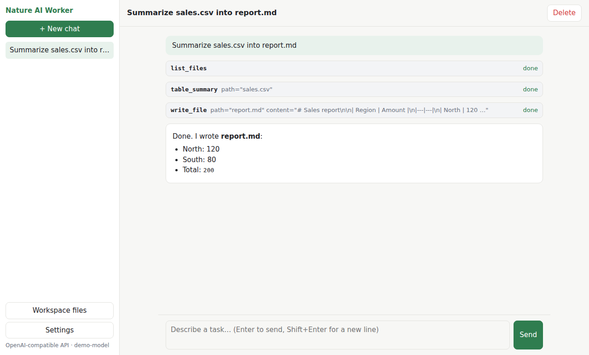

# Nature AI Worker

**A self-hosted AI agent that works on the files in a folder on your computer.**
Connect the model you already use, describe a task in plain language, and approve anything risky before it happens.

[](https://github.com/nature-ai-corp/nature-ai-worker/actions/workflows/ci.yml)
[](https://github.com/nature-ai-corp/nature-ai-worker/releases/tag/v0.1.0)
[](LICENSE)



<sub>The real web UI. This screenshot was taken during automated UI testing with a scripted test model, not a real AI model; see [Verification status](#verification-status) for real-model results. More: [approval prompt](docs/screenshots/05-approval-prompt.png), [workspace files](docs/screenshots/08-files-panel.png).</sub>

## Highlights

- **One built-in General Agent.** No agents, workflows or code to set up. It reads, searches and writes files, summarizes CSV/TSV/JSON tables, does exact arithmetic, and can fetch web pages if you turn that on.
- **You stay in control.** Overwriting or deleting a file and fetching a web page always wait for your approval. This is enforced where tools run, not just requested in the prompt.
- **Confined to one workspace folder.** Paths outside it, `..` traversal and escaping symlinks are blocked. There is no shell or code-execution tool.
- **Your model, your choice:** OpenAI, Anthropic Claude, Google Gemini, DeepSeek, Ollama (local models), or any OpenAI-compatible API.
- **Small and local.** One Python process, SQLite, and a plain web UI. API keys are encrypted at rest and only sent to the endpoint you configured.
- **Apache-2.0 licensed.**

## Quick start

Requires Python 3.11–3.14 and a model that supports tool calling (for example, a tool-capable model in Ollama). On Ubuntu or WSL, install the venv package first: `sudo apt install python3-venv` (see [Ubuntu and WSL prerequisites](#ubuntu-and-wsl-prerequisites)).

```bash
git clone https://github.com/nature-ai-corp/nature-ai-worker.git
cd nature-ai-worker
python3 -m venv .venv && source .venv/bin/activate
pip install .
nature-worker
```

Open **http://127.0.0.1:8080** (port taken? run `nature-worker --port 8081`), pick your provider and model, click **Test connection**, then **Save**. Put files in `./workspace` and describe a task.

Want something to try? The [sales report demo](examples/sales-report/) has a synthetic dataset, a ready-made task and the correct answers to check against. To run with Docker instead, see [Option B](#option-b-docker-compose).

> **Status:** [v0.1.0](https://github.com/nature-ai-corp/nature-ai-worker/releases/tag/v0.1.0), an early release for **single-user, local use**. Do not expose it to a network. See [Known limitations](#known-limitations) and [SECURITY.md](SECURITY.md).

---

## Installation

### Option A: Python 3.11–3.14

#### Ubuntu and WSL prerequisites

Ubuntu's Python does not include `venv` and `ensurepip` by default; they come in a separate package. Install it, plus `git`, once:

```bash
python3 --version                      # must be 3.11 or newer
sudo apt update
sudo apt install git python3-venv
```

`python3-venv` matches the default `python3`. If you run a specific version instead (for example `python3.13 -m venv .venv`), install that version's package: `sudo apt install python3.13-venv`. Ubuntu 24.04 ships Python 3.12, which works. Ubuntu 22.04 ships Python 3.10, which is too old: install Python 3.11 or newer, or use [Docker](#option-b-docker-compose). You do not need the system `python3-pip` package; `pip` comes with the virtual environment.

**If `python3 -m venv .venv` fails** with *"ensurepip is not available"* or *"The virtual environment was not created successfully"*:

```bash
rm -rf .venv                           # the failed attempt leaves a broken .venv folder
sudo apt install python3-venv          # or python3.X-venv, the exact package named in the error
python3 -m venv .venv
source .venv/bin/activate
python -m pip --version                # should print a pip inside .venv
```

If `pip install .` reports *"externally-managed-environment"* or `pip: command not found`, the virtual environment is not active: run `source .venv/bin/activate` and try again.

#### Install and start

```bash
git clone https://github.com/nature-ai-corp/nature-ai-worker.git
cd nature-ai-worker
python3 -m venv .venv
source .venv/bin/activate          # Windows: .venv\Scripts\activate
pip install .
nature-worker
```

Open **http://127.0.0.1:8080** in your browser.

By default, data is stored in `./data` and the workspace folder is `./workspace`, both relative to the folder you start from.

#### Use a different port

The server listens on port 8080 by default. To use another port, for example because 8080 is already taken:

```bash
nature-worker --port 8081                  # or: NATURE_WORKER_PORT=8081 nature-worker
```

Then open **http://127.0.0.1:8081**. The address stays `127.0.0.1`, so the port is still reachable only from this computer. If the port is in use, the app stops with a message such as *"Port 8080 is already in use"* and suggests another port to try. It never stops the other program; to see what is using a port, run `ss -ltnp 'sport = :8080'`.

### Option B: Docker Compose

```bash
git clone https://github.com/nature-ai-corp/nature-ai-worker.git
cd nature-ai-worker
mkdir -p data workspace            # create these first so they are owned by you
NATURE_WORKER_UID=$(id -u) NATURE_WORKER_GID=$(id -g) docker compose up -d --build
```

Requires Docker Compose v2.24 or later (for the optional `.env` file). CI builds the image and checks this exact setup on every push (see [Verification status](#verification-status)). Without `NATURE_WORKER_UID`/`NATURE_WORKER_GID`, the container runs as user 1000. If your user ID differs, `./data` must be writable by that user.

Open **http://127.0.0.1:8080**. Put files for the agent in `./workspace`.

The port is published on `127.0.0.1` only, so other machines cannot reach it. To use a different host port, set `NATURE_WORKER_PORT`, for example `NATURE_WORKER_PORT=8081` before `docker compose up -d --build` (or in `.env`), and open **http://127.0.0.1:8081**.

---

## First-run setup

The first time you open the app, a setup dialog asks for:

| Field | What to enter |
|---|---|
| **Provider** | OpenAI, Anthropic Claude, Google Gemini, DeepSeek, Ollama (local), or OpenAI-compatible API |
| **Model** | The model name, e.g. `gpt-5-mini`, `claude-sonnet-5-5`, `gemini-2.5-flash`, `deepseek-chat`, `qwen3:8b`. These are examples only; check your provider's current model list. The model must support **tool calling**. |
| **API key** | Required for cloud providers. Optional for Ollama and OpenAI-compatible servers. |
| **Endpoint URL** | Ollama: `http://localhost:11434` (from Docker: `http://host.docker.internal:11434`). OpenAI-compatible: the base URL including `/v1`, e.g. `http://localhost:1234/v1`. |

Click **Test connection** first. It makes one small real request and checks that the model can call a tool. Then click **Save**.

You can change these later under **Settings**. Settings also includes:

- **Allow web fetching**: off by default. When it is on, the agent can request public web pages, and you approve each request.
- **Max steps per task**: default 20. This is how many model calls one task may use before it stops and asks you to continue.

### Provider notes

| Provider | Notes |
|---|---|
| OpenAI | Uses the Chat Completions API. Key from platform.openai.com. |
| Anthropic | Uses the Messages API. Key from console.anthropic.com. |
| Google Gemini | Uses the Gemini API (`google-genai`). Key from aistudio.google.com. |
| DeepSeek | Uses `https://api.deepseek.com` (OpenAI-compatible). `deepseek-chat` supports tools. |
| Ollama | Run `ollama pull <model>` first. Use a model that supports tools, such as `qwen3`, `llama3.1`, or `mistral-nemo`. Models without tool support produce a clear error. |
| OpenAI-compatible | LM Studio, vLLM, LiteLLM, OpenRouter and similar. The server must support the `tools` parameter. |

---

## Using it

1. Put the files you want to work with in the workspace folder. You can also use **Workspace files → Upload file**.
2. Describe a task in the chat, for example:
   - *"Read sales.csv and write a report.md with totals per region."*
   - *"Search my notes for anything about invoices and summarize it."*
   - *"Turn meeting-notes.txt into a list of action items in actions.md."*
3. Tool calls appear in the chat as they happen; click a tool card to see its details. When the agent wants to overwrite or delete a file or fetch a web page, an **Approval needed** card appears. Nothing happens until you click **Approve** or **Deny**.
4. Results are saved in the workspace. In **Workspace files**, click a file name to preview it (read-only; `.md`, `.txt`, `.csv` and `.json` files up to 1 MB), or click ⬇ to download any file.

Conversations are saved and listed in the sidebar. They are kept after restarts.

### Built-in tools

| Tool | What it does | Approval |
|---|---|---|
| `list_files` | List files and folders in the workspace | No |
| `read_file` | Read a text file (long files are read in chunks) | No |
| `search_text` | Find text or a regex across workspace files | No |
| `table_summary` | Row and column statistics for CSV, TSV or JSON tables | No |
| `calculate` | Exact arithmetic (safe expression evaluator, no code execution) | No |
| `write_file` | Create a file | No for new files; **yes to overwrite** |
| `delete_file` | Delete a file | **Always** |
| `web_fetch` | Fetch a public web page as text (only when enabled in Settings) | **Always** |

There is no shell or Python execution tool.

---

## Configuration reference

All settings are optional environment variables (see `.env.example`):

| Variable | Default | Purpose |
|---|---|---|
| `NATURE_WORKER_HOST` | `127.0.0.1` | Bind address (`0.0.0.0` inside Docker) |
| `NATURE_WORKER_PORT` | `8080` | Listen port. `nature-worker --port N` overrides it. With Docker Compose, the host port |
| `NATURE_WORKER_DATA_DIR` | `./data` | SQLite database and encrypted credentials |
| `NATURE_WORKER_WORKSPACE` | `./workspace` | The only folder the agent can access |
| `NATURE_WORKER_ALLOWED_HOSTS` | `localhost,127.0.0.1,[::1]` | Accepted `Host` headers (DNS-rebinding protection) |
| `NATURE_WORKER_SECRET_KEY` | *(generated)* | Passphrase that encrypts saved API keys |
| `OPENAI_API_KEY`, `ANTHROPIC_API_KEY`, `GEMINI_API_KEY`, `DEEPSEEK_API_KEY`, `OPENAI_COMPATIBLE_API_KEY` | | Provider keys. If set, these override keys saved in the UI. `OPENAI_COMPATIBLE_API_KEY` is sent to whichever OpenAI-compatible endpoint is set in Settings. |

### How API keys are stored

- Keys you enter in the UI are encrypted (Fernet: AES-128-CBC with HMAC-SHA256) in `data/credentials.enc`, which has `0600` permissions.
- The encryption key is `NATURE_WORKER_SECRET_KEY` if you set it. Otherwise it is a random key in `data/master.key` (also `0600`). With the generated key, the protection comes down to file permissions. Set `NATURE_WORKER_SECRET_KEY` so that a copy of the data folder alone does not reveal your keys.
- Keys are never stored in SQLite, never returned by the API (the UI only shows whether a key is set), never stored in conversation history, and are redacted from logs.
- Alternatively, set keys only as environment variables, and nothing is written to disk.
- **Keys only go where you configured them.** OpenAI, Anthropic, Gemini and DeepSeek keys are only sent to those providers' official endpoints. A key saved for an Ollama or OpenAI-compatible endpoint is bound to that exact endpoint. If you change the endpoint, the key is not sent to the new address until you enter it again.
- SDK environment overrides are ignored (a warning at startup names any that are set): `OPENAI_BASE_URL`, `OPENAI_CUSTOM_HEADERS`, `OPENAI_ORG_ID`, `OPENAI_PROJECT_ID`, `OPENAI_ADMIN_KEY`, `ANTHROPIC_BASE_URL`, `ANTHROPIC_CUSTOM_HEADERS`, `ANTHROPIC_AUTH_TOKEN`, `GOOGLE_GEMINI_BASE_URL`, `GOOGLE_VERTEX_BASE_URL`, `GOOGLE_GENAI_USE_VERTEXAI`, `GOOGLE_GENAI_USE_ENTERPRISE`, `GOOGLE_API_KEY`. To use a proxy or gateway, choose **OpenAI-compatible API** and enter its URL in Settings.

---

## Development

```bash
python3 -m venv .venv && source .venv/bin/activate
pip install -e '.[dev]'
pytest
```

The tests run the real application, including the real provider SDKs, against a local fake model server that speaks each provider's wire format. They also start the server as a subprocess to check that data survives a restart. They do **not** contact real AI providers.

To verify against a **real** provider, run the acceptance script. It starts the server in a temporary folder and runs the acceptance scenarios through the HTTP API:

```bash
# Put the key in a private file from your own terminal (never on the command line or in a chat):
install -m 600 /dev/null ~/.nature-worker-openai-key && nano ~/.nature-worker-openai-key
.venv/bin/python scripts/acceptance.py --provider openai --model <model> --key-file ~/.nature-worker-openai-key
.venv/bin/python scripts/acceptance.py --provider ollama --model <pulled-model> --endpoint http://localhost:11434
```

Step-by-step instructions, including Ollama on another computer, are in [docs/REAL_TESTING.md](docs/REAL_TESTING.md). Results are recorded in [docs/VERIFICATION.md](docs/VERIFICATION.md).

If the service, model or key is unavailable, the script reports **NOT EXECUTED** (exit code 2) instead of failing.

It writes a Markdown report (`acceptance-<provider>.md`) containing transcripts of each scenario.

### Project layout

```
src/nature_worker/
  app.py            FastAPI routes, security middleware
  agent.py          The General Agent: bounded model/tool loop, approval pause/resume
  db.py             SQLite: conversations, messages, approvals, settings
  credentials.py    Encrypted API key storage, log redaction
  config.py         Environment configuration
  providers/        One adapter per API (OpenAI-compatible, Anthropic, Gemini, Ollama)
  tools/            Workspace sandbox, file tools, data tools, guarded web fetch
  static/           The web UI (plain HTML/CSS/JS, no build step)
tests/              Automated tests
examples/           Synthetic demo data (sales report demo)
scripts/acceptance.py   Real-provider acceptance check
```

---

## Verification status

v0.1.0 was checked as follows. Details and evidence are in [docs/VERIFICATION.md](docs/VERIFICATION.md).

| Area | How it was verified |
|---|---|
| Python 3.11, 3.12, 3.13, 3.14 | Full test suite (104 tests) in GitHub Actions on Ubuntu 24.04, with pinned dependencies |
| Docker image and Compose setup | GitHub Actions builds the image, starts it with `docker compose`, and checks health, the workspace mount, file ownership and permissions, and persistence after the container is replaced |
| OpenAI | Real acceptance run with `gpt-4.1-mini`: tool calling, report generation, workspace escape, delete approval and denial, error handling, persistence |
| Ollama | Real acceptance run with `qwen3.8:27b`: the same checks, all passed |
| Anthropic, Google Gemini, DeepSeek, other OpenAI-compatible servers | **Not yet verified against the real services.** The adapters are tested with the real SDKs against a local fake server that speaks each API's format. Please report problems. |

The automated tests never contact a real AI provider. To check a provider yourself, see [docs/REAL_TESTING.md](docs/REAL_TESTING.md).

---

## Known limitations

- **Single user, local use only.** There is no login and no user separation: anyone who can reach the port can use the agent, read the workspace and use your configured provider. The server listens on `127.0.0.1` by default, and Docker Compose publishes the port on `127.0.0.1` only. Do not bind to `0.0.0.0` or expose the port to a network without an authenticating reverse proxy in front. See [SECURITY.md](SECURITY.md) for the security model and residual risks.
- **Text files only.** The agent reads UTF-8 text, CSV/TSV and JSON. PDF, Word, Excel and images are not supported.
- **No streaming.** Replies appear when each step finishes. The UI polls for progress every second.
- **No context management.** The whole conversation is sent to the model on every step. Very long conversations eventually exceed the model's context window. The app reports this clearly; start a new conversation.
- **One run at a time per conversation.** Runs happen inside the HTTP request. If the server stops in the middle of a task, the task is not resumed. Unanswered tool calls are closed out the next time you send a message.
- **Tool-calling quality depends on the model.** Small local models may call tools poorly. Use **Test connection** to check.
- The web fetch tool returns text only (HTML, plain text, JSON, XML). It does not run JavaScript.
- **Linux first.** Tested on Linux (Ubuntu 24.04 in CI, and WSL2 during development). macOS and native Windows have not been tested; on Windows, use WSL2 or Docker.

## License

Apache License 2.0. See [LICENSE](LICENSE). The third-party dependencies and their licenses are listed in [THIRD_PARTY.md](THIRD_PARTY.md).
